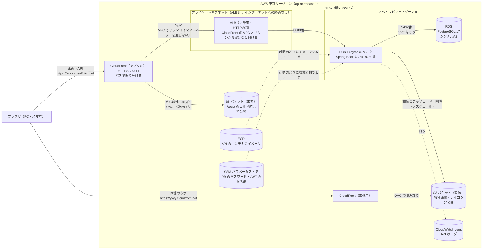

# インフラ構成：AWSデプロイ

[要件定義書](./requirements.md) の詳細ドキュメント。アプリを AWS 上に構築するときの構成と運用の考え方をまとめる。

> **ステータス: Terraform のコードあり・未構築**
> 構成は `infra/` の Terraform のコードを正とする（Issue #119・#155）。`terraform apply` はまだ行っていない。構築する手順は「構築の手順」を参照。

**EC2（サーバー）は使わない**（#155）。画面は S3 と CloudFront で配り、API（Spring Boot）はコンテナにして ECS Fargate で動かす。OS の更新・SSH の鍵・サーバーの起動と停止の管理がいらない。

## 全体構成



### リクエストの流れ

| リクエスト | 流れ |
|---|---|
| 画面（`/`, `/users/yamada` など） | ブラウザ → CloudFront（アプリ用）→ S3（画面）。画面の URL は CloudFront Functions で `/index.html` に書き換える |
| JS・CSS（`/assets/*`） | ブラウザ → CloudFront（アプリ用。キャッシュする）→ S3（画面） |
| API（`/api/...`） | ブラウザ → CloudFront（アプリ用）→ VPC オリジン → ALB（内部用）→ Fargate のタスク（Spring Boot）→ RDS |
| 画像のアップロード | ブラウザ → CloudFront（アプリ用）→ VPC オリジン → ALB（内部用）→ Spring Boot → S3（画像）（ブラウザから S3 へ直接は送らない） |
| 画像の表示 | ブラウザ → CloudFront（画像用）→ S3（画像）（API は通らない） |

- 画面と API を **CloudFront のパスで振り分ける**（`/api/*` は ALB、それ以外は S3）。ブラウザからは1つのドメインに見えるため、CORS の設定はいらない
- React はページごとの URL（`/users/yamada` など）を画面の側で扱うため、S3 にそのファイルはない。CloudFront Functions（`infra/cloudfront_functions/spa_rewrite.js`）で、**URL の最後の部分に「.」がないもの**を `/index.html` に書き換える（`/favicon.svg`・`/assets/index-xxxx.js` などのファイルはそのまま）。ユーザー名には「.」が使えない（英数字と `_` だけ）ので、画面の URL とファイルを取り違えない。書き換えは `node --test infra/cloudfront_functions/*.test.mjs` で確かめる（CI でも動く）
  - CloudFront の「エラーのときに `index.html` を返す」設定は使わない。ディストリビューション全体にかかるので、API の 404・403 まで画面に置き換わってしまうため

### HTTPS

本アプリはログインがあり、パスワードと JWT を送る。また本番では、リフレッシュトークンの Cookie に Secure 属性を付ける（`REFRESH_TOKEN_COOKIE_SECURE=true`）ため、**HTTPS でないとログインの状態を保てない**。

独自ドメインを取らずに HTTPS にするため、**CloudFront を入口にする**。CloudFront の URL（`https://xxxx.cloudfront.net`）なら、CloudFront の証明書がそのまま使える（無料）。

| 区間 | 通信 |
|---|---|
| ブラウザ → CloudFront | HTTPS（HTTP で来たら HTTPS にリダイレクトする） |
| CloudFront → S3（画面・画像） | HTTPS（OAC の署名付き） |
| CloudFront → ALB | HTTP。**VPC オリジン**で、インターネットを通らず、AWS の内部のネットワークで VPC の中の ALB（内部用）へ届く（Issue #161） |

- CloudFront は、API と `index.html` を**キャッシュしない**（`Managed-CachingDisabled`。API はログインした人ごとに中身が違う。`index.html` はデプロイしたらすぐ新しい版を返すため）。ファイル名にハッシュが付く `/assets/*`（Vite がビルドした JS・CSS）だけはキャッシュする（`Managed-CachingOptimized`）。そのため、デプロイのたびにキャッシュを消す（invalidation）必要はない
- **ブラウザのキャッシュ**（`Cache-Control`。`deploy.sh` が S3 に送るときに付ける。Issue #163）

  | ファイル | `Cache-Control` | 理由 |
  |---|---|---|
  | `/assets/*`（JS・CSS） | `public, max-age=31536000, immutable` | ファイル名に中身のハッシュが付き、中身が変わればファイル名も変わる。1年キャッシュし、変わっていないかを確かめにも来させない（2回目からの表示が速くなる） |
  | `index.html`（画面の URL も） | `no-cache` | デプロイしたらすぐ新しい版（新しい JS・CSS のファイル名）を読ませる。毎回、変わっていないかをサーバーに確かめる（変わっていなければ 304 で中身は送らない） |
  | そのほか（`favicon.svg`） | `public, max-age=86400` | ファイル名にハッシュがないので、1日にとどめる |

  `aws s3 sync` は中身の同じファイルを送り直さず、`Cache-Control` を付け直せないので、`deploy.sh` は毎回 `aws s3 cp` で送る
- `/api/*` では、ブラウザから届いたヘッダー・Cookie・検索条件を、すべてそのまま ALB に送る（`Managed-AllViewer`）。これを使わないと、CloudFront は GET の `Authorization` ヘッダー（アクセストークン）と Cookie（リフレッシュトークン）を取り除いてしまう
- CloudFront を2つに分けるのは、画面の URL（`/posts/:postId`）と画像のキー（`posts/2026/10/...`）が同じパスになり、1つでは振り分けられないため
- 独自ドメインを取ったら、CloudFront に別名（`app.example.com`）と ACM の証明書を付ける（「今後の課題」）

#### VPC オリジン

CloudFront が VPC の中に**ネットワークの口（ENI）**を作り、そこから内部用の ALB へ届く（`aws_cloudfront_vpc_origin`）。ALB はプライベートサブネットにあり、公開 IP を持たないので、**インターネットからは届かない**（DNS 名もプライベート IP を返す）。

- CloudFront から ALB までは HTTP のまま（HTTPS にするには ALB に証明書が要り、独自ドメインが必要）。ただし、インターネットには出ない
- VPC オリジンは自分のアカウントの CloudFront だけが使える。そのため、以前の「秘密のヘッダー（`X-Origin-Verify`）で、ほかの人の CloudFront から来たものを断る」仕組みはやめた
- 前提：ALB を**プライベートサブネット**（インターネットゲートウェイへの経路がないサブネット）に置く。VPC にはインターネットゲートウェイが必要（既定の VPC にはある）。東京では、アベイラビリティゾーン `apne1-az3` は使えない
- 初めて VPC オリジンを作るとき、CloudFront がサービスにリンクされたロール（`AWSServiceRoleForCloudFrontVPCOrigin`）と、セキュリティグループ（`CloudFront-VPCOrigins-Service-SG`）を自動で作る。どちらも AWS が管理するので触らない
- VPC オリジンの作成・変更には 10〜15 分かかる

## 構成要素

| 要素 | 方針 | Terraform |
|---|---|---|
| リージョン | 東京（ap-northeast-1） | `main.tf` |
| ネットワーク | 既定の VPC を使う（本棚アプリと同じ）。Fargate と RDS は既定のサブネット（パブリック）に置く。ALB 用に**プライベートサブネットを2つ**（`172.31.128.0/24`・`172.31.129.0/24`。Fargate のいるアベイラビリティゾーンともう1つ）と、インターネットへの経路を持たないルートテーブルを作る。ALB と RDS はどちらも2つ以上のアベイラビリティゾーンのサブネットを指定する必要がある。RDS は既定のサブネットをすべて指定する | `main.tf`・`network.tf` |
| HTTPS の入口 | CloudFront（アプリ用）。オリジンは画面の S3 と ALB（VPC オリジン）の2つ | `cloudfront_app.tf` |
| 画面の配信 | S3 バケット（`sns-app-frontend-<アカウントID>`）。パブリックアクセスはすべてブロックし、アプリ用の CloudFront（OAC）からだけ読める。画面の URL の書き換えは CloudFront Functions | `frontend.tf` |
| ロードバランサー | ALB（内部用。プライベートサブネット）。リスナーは HTTP 80番。`/api/*` だけを API のターゲットグループ（ターゲットの種類は IP）へ送る。Fargate のタスクは入れ替えのたびに IP が変わるので、決まった名前で受け付ける入口として ALB を使う | `alb.tf` |
| API | ECS Fargate のタスク1つ（0.5 vCPU・1GB。CPU は ARM64）。Spring Boot の jar を、Java 25（Amazon Corretto 25）のコンテナで動かす（`backend/Dockerfile`）。root では動かさない | `ecs.tf` |
| コンテナのイメージ | ECR（`sns-app-backend`）。送ったときに脆弱性を調べる（基本スキャン。OS のパッケージを調べる）。`deploy.sh` はスキャンの終わりを待ち、**CRITICAL が1件でもあれば入れ替えずに止める**（`ALLOW_CRITICAL_VULNERABILITIES=1` で進める）。HIGH は一覧を出して知らせる。Java のライブラリは基本スキャンでは調べないので、Dependabot で更新する（調べるには拡張スキャン（Amazon Inspector。有料）が要る）。イメージは来歴情報を付けずに作る（`docker build --provenance=false --sbom=false`）。付けるとタグがイメージインデックスを指し、スキャンの結果をタグで引けないため。古いイメージは5つまで残して消す | `ecs.tf`・`deploy.sh` |
| 秘密の値 | SSM パラメータストア（SecureString。標準のパラメータは無料）。DB のパスワードは Terraform が `terraform.tfvars` の値から作る。**JWT の署名鍵は `deploy.sh` が初回だけ作る**（Terraform の state にも手元にも値を残さない）。タスク定義の `secrets` で、起動のときに環境変数として渡す | `ecs.tf`・`deploy.sh` |
| ログ | CloudWatch Logs（`/ecs/sns-app-backend`。14日残す）。Spring Boot は本番で JSON（ECS 形式）のログを出す | `ecs.tf` |
| データベース | RDS for PostgreSQL 17（db.t3.micro、20GB、シングルAZ。Fargate と同じアベイラビリティゾーン）。`publicly_accessible = false` でインターネットに公開しない | `rds.tf` |
| 画像の保存 | S3 バケット1つ（`sns-app-images-<アカウントID>`）。パブリックアクセスはすべてブロックする。フォルダ（プレフィックス）を `posts/` と `icons/` に分ける | `images.tf` |
| 画像の配信 | CloudFront（画像用）。OAC（Origin Access Control）で、CloudFront からだけ S3 を読めるようにする | `images.tf` |
| 請求アラート | AWS Budgets。月の予算（既定 30 ドル）を超えそう・80% を超えたらメールで知らせる | `budget.tf` |
| 監視のアラーム | CloudWatch Alarms。[ログ・監視の運用方針](./observability.md)の監視項目を、ALB・ECS・RDS のメトリクスと、ログから作るメトリクス（メトリクスフィルター）で見る。P1・P2 は SNS でメールに知らせ、P3 は記録だけ（「7.5 段階 2 の実装」） | `monitoring.tf` |
| 性能テストの道具 | 一度きりの ECS のタスク（`postgres:17` の psql）のタスク定義。VPC の中の RDS に、性能テスト専用の DB `sns_perf` を作り、データを入れ、SQL の集計を取るために使う。変数 `perf_test = true` で apply すると、API を `sns_perf` につなぎ、Actuator の metrics を公開する（既定は false。測り終えたら戻す）。手順は[パフォーマンステスト計画書](./performance-test-plan.md)「AWS での手順」 | `perf.tf` |
| 構築方法 | Terraform（`infra/` 配下）。構成の正確な内容はコードを正とする | |

### ALB のターゲットグループとリスナー

| ターゲットグループ | 振り分ける条件 | 転送先 | ヘルスチェック |
|---|---|---|---|
| backend | `/api/*` | Fargate のタスクの 8080番（IP で登録。登録と解除は ECS のサービスが行う） | `GET /api/health` が 200（Spring Boot Actuator の health を `/api/health` で公開している） |
| （なし） | それ以外 | 403 を返す | |

### ECS のサービス

| 設定 | 値 | 理由 |
|---|---|---|
| タスクの数 | Terraform では 0 で作り、`deploy.sh` が 1 にする（`desired_count` は Terraform が戻さない） | 作った直後は、イメージと JWT の署名鍵がまだないため |
| 入れ替え | 新しいタスクが ALB のヘルスチェックに通ってから、古いタスクを止める（最小 100%・最大 200%） | デプロイの間も止まらないように |
| 失敗したとき | 新しいタスクが起動に失敗し続けたら、入れ替えをやめて前の版に戻す（デプロイのサーキットブレーカー） | 壊れた版で止まり続けないように |
| 起動の猶予 | 180秒（その間はヘルスチェックの失敗でタスクを止めない） | Spring Boot の起動（Flyway を含む）を待つため |
| 起動を速くする | **AOT キャッシュ**（Java 25）。イメージを作るときに一度アプリを試しに起動し（DB なし・Flyway なし・部品を作り終えた時点で終了）、読み込んだクラスの情報を `app.aot` に保存しておき、本番の起動で使う。jar は展開した形（`app.jar` と `lib/`）で入れる（`backend/Dockerfile`。Issue #166） | 0.5 vCPU では起動に 35〜41 秒かかっていた → 約 20 秒。デプロイとタスクの入れ替えが速くなる。メモリの使用量は変わらない。イメージは約 130MB 大きくなる |
| GC | Serial GC を明示する（`-XX:+UseSerialGC`） | 0.5 vCPU・1GB では、Java が自動で Serial GC を選ぶ。AOT キャッシュを作るときと使うときで揃える必要があるので、明示する |
| 置く場所 | RDS と同じアベイラビリティゾーンのパブリックサブネット。公開IP を付ける | ECR・SSM・S3 に接続するため。プライベートサブネットに置くと NAT ゲートウェイが必要になり、費用がかかる |
| コンテナに入る | ECS Exec（`aws ecs execute-command`。手元に Session Manager プラグインが必要） | SSH の代わり。調べものをするときに使う |

### セキュリティグループ

送信元は IP アドレスではなく、できるだけセキュリティグループ単位で絞る（本棚アプリと同じ方針）。**インターネットから直接受け付けるものはない**。

| 対象 | 受け付ける接続 |
|---|---|
| ALB | HTTP（80番）：**CloudFront からだけ**（AWS が管理するプレフィックスリスト `com.amazonaws.global.cloudfront.origin-facing`。VPC オリジンからの接続もこの範囲から来る）。ALB は内部用なので、そもそもインターネットからは届かない |
| API（Fargate のタスク） | 8080番：**ALB のセキュリティグループからだけ**。SSH はない（ECS Exec を使う） |
| RDS | PostgreSQL（5432番）：API のタスクのセキュリティグループからだけ |

- タスクには公開IP が付くが、セキュリティグループで ALB 以外からの接続を受け付けない
- S3・CloudFront・ECR・SSM はセキュリティグループではなく、IAM ロールとバケットポリシーで守る

### S3 バケットポリシーと IAM ロール

| 誰が | できること |
|---|---|
| API のタスクロール | 画像のバケットへの `s3:PutObject`・`s3:DeleteObject`（アップロードと削除）。ECS Exec 用の `ssmmessages:*Channel` |
| タスクの実行ロール（ECS がタスクを起動するときに使う） | ECR からイメージを取る・ログを送る（`AmazonECSTaskExecutionRolePolicy`）。SSM のこのアプリの2つのパラメータを読む（`ssm:GetParameters`） |
| CloudFront（アプリ用・OAC） | 画面のバケットの `s3:GetObject`（読み取り）と `s3:ListBucket`（一覧。ないファイルを 403 ではなく 404 にするため。Issue #165）。`AWS:SourceArn` で自分のディストリビューションに限る |
| CloudFront（画像用・OAC） | 画像のバケットの `s3:GetObject`・`s3:ListBucket`。同上 |
| それ以外（インターネット） | 何もできない |

- **`s3:ListBucket` を許可する理由と注意**：S3 は、一覧の権限がない相手には、ないファイルを「ない（404）」と教えずに 403 を返す。許可すると 404 になる。ただし、バケットのルート（`/`）への GET は「一覧を取る」操作になるので、**CloudFront の `/` が S3 のルートに届かないようにする**（アプリ用・画像用とも `default_root_object = "index.html"` で、`/` を `index.html` の取得に置き換える）。検索条件（`?list-type=2` など）は、どちらの CloudFront も S3 に送らない。`deploy.sh` で「画像用の CloudFront の `/` が 404」であることを確かめる

- 画像は CloudFront に最長1日ほどキャッシュされる（`Managed-CachingOptimized`）。投稿を削除すると S3 のファイルは消えるが、URL を知っている人は、キャッシュが切れるまで見られることがある

### セキュリティのヘッダー

S3 は画面の応答にセキュリティのヘッダーを付けないので、CloudFront の**レスポンスヘッダーポリシー**で付ける（`infra/security_headers.tf`。Issue #160）。アプリ用の CloudFront は、画面・`/assets/*`・`/api/*` のすべてに同じポリシーを付ける（Spring も一部を付けるが、HTTP で受けているので HSTS は付かない）。

| ヘッダー | アプリ用 | 画像用 | 防ぐもの |
|---|---|---|---|
| `Strict-Transport-Security` | `max-age=31536000`（1年） | 同じ | HTTP への格下げ（一度来たブラウザは、次から必ず HTTPS でつなぐ）。`cloudfront.net` のほかのサブドメインは他人のものなので、`includeSubDomains`・`preload` は付けない |
| `Content-Security-Policy` | 下の表 | `default-src 'none'; img-src 'self'; style-src 'unsafe-inline'; sandbox` | XSS で入れられたスクリプトや、ほかの場所からの読み込み。画像用は、URL を直接開いたときに、万一中身が HTML や SVG でもスクリプトを動かさない |
| `X-Frame-Options` | `DENY` | — | ほかのサイトの枠（iframe）に埋め込む攻撃（クリックジャッキング） |
| `X-Content-Type-Options` | `nosniff` | 同じ | `Content-Type` と違う種類として解釈させる攻撃 |
| `Referrer-Policy` | `strict-origin-when-cross-origin` | 同じ | ほかのサイトへ移るときに、URL のパス（投稿 ID など）を送らない |
| `Permissions-Policy` | カメラ・マイク・位置情報・決済・USB を使わせない | — | 使わない機能の悪用 |

アプリ用の CSP：

| 指定 | 値 | 理由 |
|---|---|---|
| `default-src`・`script-src`・`style-src`・`connect-src`・`font-src` | `'self'` | JS・CSS・API はすべて同じドメイン。外部のサイトから読み込むものはない。`'unsafe-inline'` は入れない（`index.html` にインラインのスクリプト・スタイルはなく、React の `style` 属性は DOM の API で入るので許可はいらない） |
| `img-src` | `'self' blob: https://<画像用の CloudFront>` | 投稿とアイコンの画像。`blob:` は画像を選んだときのプレビュー（`URL.createObjectURL`） |
| `object-src` | `'none'` | プラグイン（`<object>`・`<embed>`）を使わない |
| `base-uri`・`form-action` | `'self'` | `<base>` やフォームの送信先を書き換える攻撃 |
| `frame-ancestors` | `'none'` | `X-Frame-Options: DENY` と同じ（CSP の新しい書き方） |

- 外部のサイト（フォント・解析ツールなど）から読み込むものを足すときは、CSP にそのドメインを足す。足さないと、ブラウザが読み込みを止める（コンソールに「Refused to ...」と出る）
- CSP は CloudFront が付けるので、手元の開発サーバーや E2E テストでは効かない。デプロイしたあと、本番のスモークテスト（`SMOKE_URL=<アプリの URL> npm run test:smoke`。`frontend/smoke/`）で、画面を操作しても CSP の違反が出ないことを確かめる

## 本番用の設定

Spring Boot の `application-production.yml` で、次の値を環境変数から受け取る。値はタスク定義に Terraform が入れる（秘密の値は SSM パラメータストアから ECS が入れる）。プロファイル（`production`）は `backend/Dockerfile` で指定している。

| 役割 | 環境変数 | 内容 |
|---|---|---|
| DB の接続先 | `DB_HOST`・`POSTGRES_PORT`・`POSTGRES_DB`・`POSTGRES_USER` | RDS のエンドポイントとユーザー名（ローカルの `.env` と同じ名前） |
| DB のパスワード | `POSTGRES_PASSWORD`（SSM：`/sns-app/db-password`） | `terraform.tfvars` の `db_password` |
| JWT の署名鍵 | `JWT_SECRET`（SSM：`/sns-app/jwt-secret`） | 初めてデプロイするときに `deploy.sh` が作る（`openssl rand`）。2回目以降は同じ値を使う（変えると全員ログアウトになる）。リポジトリにも手元にも Terraform の state にも置かない。`terraform destroy` では消えない（無料なので残してよい。消すときは `aws ssm delete-parameter`） |
| リフレッシュトークンの Cookie | `REFRESH_TOKEN_COOKIE_SECURE=true` | Cookie に Secure 属性を付け、HTTPS のときだけ送らせる |
| S3 | `S3_BUCKET`・`AWS_REGION`・`S3_ENDPOINT`（空にする） | バケット名とリージョン。`S3_ENDPOINT` はローカルの LocalStack 用なので、本番では空にする（空なら AWS の S3 に接続する）。アクセスキーはタスクロールから自動で取得されるため設定しない |
| 画像の配信元 | `IMAGE_BASE_URL` | 画像用の CloudFront の URL（例: `https://dxxxxxxxx.cloudfront.net`）。`application-production.yml` では既定値を置かないので、設定し忘れると起動時にエラーになる |
| API 仕様書（Swagger UI） | `SPRINGDOC_ENABLED`（設定不要） | 本番では仕様書（`/v3/api-docs`）と Swagger UI（`/swagger-ui.html`）を閉じ、API の一覧を外に見せない（404 になる）。`application-production.yml` で既定を閉じているので、環境変数は設定しなくてよい（設定し忘れても公開されない）。ローカル開発（`application.yml`）の既定は開く |
| ログのバージョン | `APP_VERSION` | ログに入れるリリースの版。`deploy.sh` が git のコミットの短いハッシュをイメージに入れる（`docker build --build-arg`。コミットしていない変更があれば `-dirty` を付ける）。本番のログは JSON（ECS）で出す（[ログ・監視の運用方針](./observability.md)） |
| メモリ | （Dockerfile の `-XX:MaxRAMPercentage=75`） | Java が使うメモリは、タスクのメモリ（1GB）の 75% まで |
| アップロードサイズ | `spring.servlet.multipart.max-file-size`・`max-request-size`（`application.yml` に設定済み。環境変数は不要） | 画像は1枚5MBまで（アプリの入力チェックで項目ごとのエラーにする）。multipart の上限は少し大きめに、1ファイル10MB・1回のリクエスト25MB（4枚＋本文）にしてあり、超えると 413 |

- フロントエンドは API を同じドメインの `/api` で呼ぶので、API の URL をビルド時に埋め込む必要がない
- API のログは CloudWatch Logs に出る（`aws logs tail /ecs/sns-app-backend --follow`）

## 開発環境との対応

ローカルの開発環境は Docker Compose で AWS の各サービスを置き換える。

| 本番（AWS） | 開発環境（ローカル） |
|---|---|
| CloudFront（アプリ用。HTTPS） | なし（HTTP の `localhost:5173`。Cookie の Secure 属性は付けない） |
| CloudFront のパスの振り分け | Vite の開発サーバーのプロキシ（`/api` を `localhost:8080` に中継） |
| S3（画面）＋CloudFront Functions | Vite の開発サーバー（`localhost:5173`。画面の URL は Vite が `index.html` を返す） |
| ECS Fargate（API のコンテナ） | Spring Boot（`localhost:8080`。`./gradlew bootRun`） |
| RDS for PostgreSQL | PostgreSQL 17 のコンテナ（`postgres:17`） |
| S3（画像） | LocalStack のコンテナ（`localstack/localstack:4.14.0`、`localhost:4566`）。起動時にバケット `sns-app-images` を作る（`localstack/init/ready.d/create-bucket.sh`）。接続先・認証情報はバックエンドの設定（`app.storage`）でローカル用に切り替える |
| CloudFront（画像用） | なし（LocalStack の S3 の URL から直接表示する） |
| SSM パラメータストア | `.env`（Git に入れない） |

- 本番のコンテナは、ローカルでも動かして確かめられる（`backend/Dockerfile`。ローカルの DB と LocalStack につなぎ、`production` の設定で登録・ログイン・画像付きの投稿まで動くことを #155 で確かめた）

## 費用

EC2 の無料利用枠（月750時間）を使わない代わりに、サーバーの管理がいらない。**Fargate と ALB は無料利用枠だけには収まらない**点に注意する。

| 項目 | 無料利用枠 | 今回の使い方 |
|---|---|---|
| **ECS Fargate** | なし | 動いている時間だけ、CPU とメモリの量に応じて課金される（0.5 vCPU・1GB・ARM64 で、1日中動かすと月に 2,000〜3,000 円程度）。使わないときは `infra/servers.sh stop` でタスクを 0 にする |
| 公開IPv4 | 月750時間（12か月） | Fargate のタスクに1つ（動いている間だけ）。ALB は内部用なので付かない |
| CloudFront の VPC オリジン | 追加の料金なし | 1つ使う |
| **ALB** | アカウント作成から12か月は月750時間の無料枠あり。それ以降は**止める機能がない**ため、存在しているだけで時間課金される（月に数千円程度） | 使う期間だけ作り、使わない期間は `terraform destroy` で ALB ごと削除する |
| RDS | 月750時間・20GB | 1日中動かしても収まる。自動バックアップは取らない |
| ECR | 月500MB（12か月） | イメージ1つは約 200MB。5つまで残すので、少し超えることがある（1GB で月に十数円程度） |
| CloudWatch Logs | 月5GB の取り込み・保存 | 14日で消すので、学習用なら収まる |
| CloudWatch のアラーム・メトリクス | アラームのメトリクス10個、カスタムメトリクス10個 | アラームのメトリクスは13個（5xx の割合は3つのメトリクスを使う）なので、少し超える（月に数十円）。ログから作るメトリクスは6個で収まる |
| SNS（アラームの通知） | メール1,000件 | 収まる |
| SSM パラメータストア | 標準のパラメータは無料 | 2つ使う |
| S3 | 5GB（12か月） | 学習用の画像と画面のファイルなら収まる |
| CloudFront・CloudFront Functions | 月1TBの転送・1,000万リクエスト・200万回の関数の実行（常時無料） | 2つ合わせても収まる |
| AWS Budgets | 通知だけの予算（自動の操作を付けないもの）は無料 | 1つ使う |

- 料金の目安は変わることがあるので、構築前に AWS の料金ページで確認する
- 請求アラート（AWS Budgets）と監視のアラームは Terraform で一緒に作る。通知先のメールアドレスは `terraform.tfvars` の `budget_alert_email`。監視のアラームは、初回に AWS から確認のメール（AWS Notification - Subscription Confirmation）が届くので、リンクを押して承認する（押すまで通知は届かない）

## 構築の手順

### 1. Terraform・デプロイを実行する IAM ユーザーに権限を付ける

Terraform と `deploy.sh` を実行する IAM ユーザーに、`infra/terraform-iam-policy.json` のポリシーを付ける（管理者のアカウントで、IAM のコンソールからポリシーを作って付ける）。作るリソースの名前（`sns-app-*`）に絞れるもの（RDS・S3・ECR・ECS・ログ・SSM・IAM ロール・予算）は絞ってある。

### 2. 値を用意する

```bash
cp infra/terraform.tfvars.example infra/terraform.tfvars      # 値を入れる（Git には入れない）
```

- Docker（イメージを作る）・Java 25・Node.js・AWS CLI（認証済み）が手元に必要
- イメージの CPU の種類は、手元の PC と合わせる（Apple シリコンの Mac なら既定の `ARM64` のまま。Intel の PC なら `backend_cpu_architecture = "X86_64"`）

### 3. 作る

```bash
terraform -chdir=infra init
terraform -chdir=infra plan     # 作られるものを確かめる
terraform -chdir=infra apply    # 15〜20分ほどかかる（RDS と CloudFront に時間がかかる）
infra/deploy.sh                 # ビルドして配置し、動作を確認する
```

- `deploy.sh` の最後に、画面・画面の URL を直接開く・API・ない API（画面にならないこと）・ALB への直接アクセス（つながらないこと）・ALB の DNS 名がプライベート IP だけを返すこと・セキュリティのヘッダー（CSP・HSTS）を確かめる
- 画面を変えたときは、続けて本番のスモークテストを実行する（`cd frontend && SMOKE_URL=$(terraform -chdir=../infra output -raw app_url) npm run test:smoke`）。ログイン・画像つき投稿・画像の表示・アイコンのプレビューを本物のブラウザで操作し、CSP の違反やエラーがないことを確かめる
- AWS Budgets の通知先のメールアドレスには、確認のメールは届かない（そのまま通知が届く）

## デプロイ・運用の考え方

**ビルドはすべてローカルで行い、成果物だけを AWS に送る**（`infra/deploy.sh`）。

- API：`./gradlew bootJar` で jar を作り、`docker build` でイメージにして ECR に送る（タグは git の短いハッシュと `latest`）。ECS のサービスを入れ替え（`update-service --force-new-deployment`）、新しいタスクが ALB のヘルスチェックに通るまで待つ。始めた入れ替えの結果を ID で確かめ、失敗して前の版に戻ったときは、最近のログを出して止まる（#178）
- 画面：`npm run build` で作った `dist/` を S3 に送る。JS・CSS を先に送り、最後に `index.html` を送る（途中で、古い `index.html` が新しいファイルを探さないように）。前の版の JS・CSS は消さない（入れ替えの途中で、古い画面を開いている人が読み込めなくならないように）
- DB のテーブルは、Spring Boot の起動時に Flyway が作成・更新する
- API の起動・停止は `infra/servers.sh start|stop|status`（ECS のタスクの数を 1／0 にする）。画面（S3・CloudFront）は止めなくてよい。`stop` は「API の正常なタスクがない」アラームの通知を止めてから止め、`start`・`deploy.sh` が通知を戻す（わざと止めたときに鳴らないように）
- タスクを止めている間にアプリを開くと、画面は出るが、API は ALB が 503 を返す（ログインなどができない）
- ALB は止められないため、使わない期間は `terraform destroy` で環境ごと削除する（RDS のデータと S3 の画像も消えるので、残したい場合は先にスナップショットを取る）

## 今後の課題（未対応）

| 項目 | 内容 |
|---|---|
| 独自ドメイン | 取得したら、Route 53 と ACM（us-east-1 の証明書）を使って、アプリ用の CloudFront に別名を付ける |
| 冗長化 | 今はタスク1つ・RDS はシングルAZ。必要になったらタスクを2つにしてアベイラビリティゾーン c にも置き、RDS をマルチAZにする（ALB があるので、タスクを増やすのは `desired_count` を変えるだけ）。ただし、ログインの試行回数の記録（#159）はタスクのメモリにあるので、タスクを増やすときは DB などの共有の場所に移す（BCrypt の同時実行の制限（#176）は、タスクごとに絞ればよいのでそのままでよい） |
| API の CPU | 0.5 vCPU では、ログイン（BCrypt の照合）は1秒に3件ほどが上限（[性能テストの結果](./performance-test-results.md)「AWS での測定」）。超えた分は「混み合っています」（503）を返す。利用者が増えたら、タスクの CPU を 1 vCPU に上げる（`backend_cpu`） |
| Terraform の state | ローカル保存からリモート（S3）保存への移行 |
| デプロイの自動化 | `deploy.sh` を GitHub Actions に移す（OIDC で AWS に入り、main にマージしたらデプロイする） |
| ログ・監視 | [ログ・監視の運用方針](./observability.md)の段階 2 の残り（ダッシュボード・外形監視、ALB のアクセスログ、ログの長期保存）を Terraform に入れる。ログの送り先（CloudWatch Logs）は #155、アラームは #162 で入れた |
| WAF | 公開して不正なアクセスが増えたら、CloudFront に AWS WAF を付ける（有料） |
