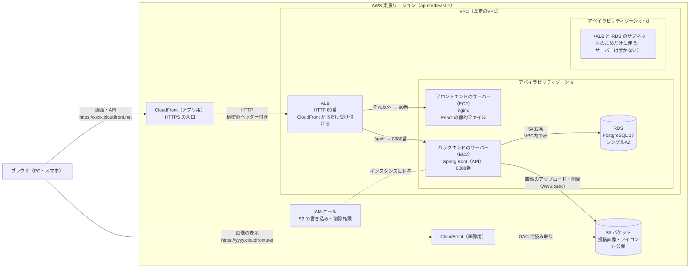

# インフラ構成：AWSデプロイ

[要件定義書](./requirements.md) の詳細ドキュメント。アプリを AWS 上に構築するときの構成と運用の考え方をまとめる。

> **ステータス: Terraform のコードあり・未構築**
> 構成は `infra/` の Terraform のコードを正とする（Issue #119）。`terraform apply` はまだ行っていない。構築する手順は「構築の手順」を参照。

構成は、前回の本棚アプリ（`bookshelf-app`）の AWS 構成をもとにした。フロントエンドとバックエンドを別々のサーバーに分ける点は同じで、前にロードバランサー（ALB）と CloudFront を置く点が違う。

## 全体構成



### リクエストの流れ

| リクエスト | 流れ |
|---|---|
| 画面（`/`, `/users/yamada` など） | ブラウザ → CloudFront（アプリ用）→ ALB → フロントエンドのサーバー（nginx が `index.html` と JS・CSS を返す） |
| API（`/api/...`） | ブラウザ → CloudFront（アプリ用）→ ALB → バックエンドのサーバー（Spring Boot）→ RDS |
| 画像のアップロード | ブラウザ → CloudFront（アプリ用）→ ALB → Spring Boot → S3（ブラウザから S3 へ直接は送らない） |
| 画像の表示 | ブラウザ → CloudFront（画像用）→ S3（アプリのサーバーは通らない） |

- 画面と API を **ALB のパスで振り分ける**（`/api/*` はバックエンド、それ以外はフロントエンド）。ブラウザからは1つのドメインに見えるため、CORS の設定はいらない
  - 本棚アプリでは nginx が `/api` をバックエンドへ中継していたが、今回はその役割を ALB が受け持つ
- React はページごとの URL（`/users/yamada` など）を画面側で扱うため、nginx は存在しないパスにも `index.html` を返す（`try_files $uri /index.html;`）

### HTTPS

本アプリはログインがあり、パスワードと JWT を送る。また本番では、リフレッシュトークンの Cookie に Secure 属性を付ける（`REFRESH_TOKEN_COOKIE_SECURE=true`）ため、**HTTPS でないとログインの状態を保てない**。

独自ドメインを取らずに HTTPS にするため、**CloudFront を入口にする**。CloudFront の URL（`https://xxxx.cloudfront.net`）なら、CloudFront の証明書がそのまま使える（無料）。

| 区間 | 通信 |
|---|---|
| ブラウザ → CloudFront | HTTPS（HTTP で来たら HTTPS にリダイレクトする） |
| CloudFront → ALB | HTTP（AWS の中を通る） |

- CloudFront は、画面と API の応答を**キャッシュしない**（`Managed-CachingDisabled`。ログインした人ごとに中身が違うため）。ファイル名にハッシュが付く `/assets/*`（Vite がビルドした JS・CSS）だけはキャッシュする
- ブラウザから届いたヘッダー・Cookie・検索条件は、すべてそのまま ALB に送る（`Managed-AllViewer`）。これを使わないと、CloudFront は GET の `Authorization` ヘッダー（アクセストークン）と Cookie（リフレッシュトークン）を取り除いてしまう
- CloudFront を2つに分けるのは、画面の URL（`/posts/:postId`）と画像のキー（`posts/2026/10/...`）が同じパスになり、1つでは振り分けられないため
- 独自ドメインを取ったら、CloudFront に別名（`app.example.com`）と ACM の証明書を付ける（「今後の課題」）

## 構成要素

| 要素 | 方針 | Terraform |
|---|---|---|
| リージョン | 東京（ap-northeast-1） | `main.tf` |
| ネットワーク | 既定の VPC とそのサブネットを使う（本棚アプリと同じ）。ALB と RDS はどちらも**2つ以上のアベイラビリティゾーンのサブネットを指定する必要がある**。ALB はサブネットごとに公開IPv4 が付いて課金されるので、EC2 のいるアベイラビリティゾーンともう1つの2つにする。RDS は既定のサブネットをすべて指定する | `main.tf` |
| HTTPS の入口 | CloudFront（アプリ用）。オリジンは ALB | `cloudfront_app.tf` |
| ロードバランサー | ALB。リスナーは HTTP 80番。パスで2つのターゲットグループに振り分ける | `alb.tf` |
| フロントエンドのサーバー | EC2（Amazon Linux 2023、t3.micro）1台。nginx で React（Vite）のビルド結果（`dist/`）を返す | `ec2.tf`・`user_data_frontend.sh` |
| バックエンドのサーバー | EC2（Amazon Linux 2023、t3.micro）1台。Spring Boot の jar を Java 25（Amazon Corretto 25）で動かす（systemd のサービス `sns-app-backend` として常駐） | `ec2.tf`・`user_data_backend.sh` |
| データベース | RDS for PostgreSQL 17（db.t3.micro、20GB、シングルAZ。バックエンドと同じアベイラビリティゾーン）。`publicly_accessible = false` でインターネットに公開しない | `rds.tf` |
| 画像の保存 | S3 バケット1つ（`sns-app-images-<アカウントID>`）。パブリックアクセスはすべてブロックする。フォルダ（プレフィックス）を `posts/` と `icons/` に分ける | `images.tf` |
| 画像の配信 | CloudFront（画像用）。OAC（Origin Access Control）で、CloudFront からだけ S3 を読めるようにする | `images.tf` |
| S3 へのアクセス権限 | バックエンドの EC2 に IAM ロール（インスタンスプロファイル）を付ける。**アクセスキーをサーバーに置かない** | `ec2.tf` |
| 請求アラート | AWS Budgets。月の予算（既定 30 ドル）を超えそう・80% を超えたらメールで知らせる | `budget.tf` |
| 構築方法 | Terraform（`infra/` 配下）。構成の正確な内容はコードを正とする | |

### ALB のターゲットグループとリスナー

| ターゲットグループ | 振り分ける条件 | 転送先 | ヘルスチェック |
|---|---|---|---|
| backend | `/api/*` かつ秘密のヘッダーあり | バックエンドの EC2 の 8080番 | `GET /api/health` が 200（Spring Boot Actuator の health を `/api/health` で公開している） |
| frontend | それ以外で秘密のヘッダーあり | フロントエンドの EC2 の 80番 | `GET /` が 200 |
| （なし） | 秘密のヘッダーなし | 403 を返す | |

- **秘密のヘッダー**（`X-Origin-Verify`）：CloudFront がオリジンへのリクエストに付ける値。値は Terraform が作り（`random_password`）、state にだけ残る。セキュリティグループの CloudFront の送信元の一覧は「どこかの CloudFront」なので、ほかの人が作った CloudFront から ALB に来たものはここで断る

### セキュリティグループ

送信元は IP アドレスではなく、できるだけセキュリティグループ単位で絞る（本棚アプリと同じ方針）。**インターネットから直接受け付けるものはない**。

| 対象 | 受け付ける接続 |
|---|---|
| ALB | HTTP（80番）：**CloudFront からだけ**（AWS が管理するプレフィックスリスト `com.amazonaws.global.cloudfront.origin-facing`） |
| フロントエンドのサーバー | HTTP（80番）：**ALB のセキュリティグループからだけ**。SSH（22番）：自分のPCのIPからだけ |
| バックエンドのサーバー | 8080番：**ALB のセキュリティグループからだけ**。SSH（22番）：自分のPCのIPからだけ |
| RDS | PostgreSQL（5432番）：バックエンドのサーバーのセキュリティグループからだけ |

- EC2 は既定の VPC のパブリックサブネットに置く（プライベートサブネットに置くと、OS の更新などのために NAT ゲートウェイが必要になり、費用がかかるため）。その代わり、セキュリティグループで ALB 以外からの HTTP を受け付けない
- S3 と CloudFront はセキュリティグループではなく、IAM ロールとバケットポリシーで守る

### S3 バケットポリシーと IAM ロール

| 誰が | できること |
|---|---|
| バックエンドの EC2（IAM ロール） | `s3:PutObject`・`s3:DeleteObject`（アップロードと削除）。対象はこのバケットだけ |
| CloudFront（画像用・OAC） | `s3:GetObject`（読み取りだけ）。`AWS:SourceArn` で自分の画像用のディストリビューションに限る |
| それ以外（インターネット） | 何もできない |

- 画像は CloudFront に最長1日ほどキャッシュされる（`Managed-CachingOptimized`）。投稿を削除すると S3 のファイルは消えるが、URL を知っている人は、キャッシュが切れるまで見られることがある

## 本番用の設定

Spring Boot の `application-production.yml` で、次の値を環境変数から受け取る。値は `infra/deploy.sh` が Terraform の出力値と `terraform.tfvars` から作って配置する。

| 役割 | 環境変数 | 内容 |
|---|---|---|
| DB の接続先 | `DB_HOST`・`POSTGRES_PORT`・`POSTGRES_DB`・`POSTGRES_USER`・`POSTGRES_PASSWORD` | RDS のエンドポイントと認証情報（ローカルの `.env` と同じ名前） |
| JWT の署名鍵 | `JWT_SECRET` | 初めてデプロイするときに**サーバー上でだけ作る**（`/opt/sns-app/jwt_secret`）。2回目以降は同じ値を使う（変えると全員ログアウトになる）。リポジトリにもローカルにも置かない |
| リフレッシュトークンの Cookie | `REFRESH_TOKEN_COOKIE_SECURE=true` | Cookie に Secure 属性を付け、HTTPS のときだけ送らせる |
| S3 | `S3_BUCKET`・`AWS_REGION`・`S3_ENDPOINT`（空にする） | バケット名とリージョン。`S3_ENDPOINT` はローカルの LocalStack 用なので、本番では空にする（空なら AWS の S3 に接続する）。アクセスキーは IAM ロールから自動で取得されるため設定しない |
| 画像の配信元 | `IMAGE_BASE_URL` | 画像用の CloudFront の URL（例: `https://dxxxxxxxx.cloudfront.net`）。`application-production.yml` では既定値を置かないので、設定し忘れると起動時にエラーになる |
| API 仕様書（Swagger UI） | `SPRINGDOC_ENABLED`（設定不要） | 本番では仕様書（`/v3/api-docs`）と Swagger UI（`/swagger-ui.html`）を閉じ、API の一覧を外に見せない（404 になる）。`application-production.yml` で既定を閉じているので、環境変数は設定しなくてよい（設定し忘れても公開されない）。ローカル開発（`application.yml`）の既定は開く |
| ログのバージョン | `APP_VERSION` | ログに入れるリリースの版。`deploy.sh` が git のコミットの短いハッシュを入れる（コミットしていない変更があれば `-dirty` を付ける）。本番のログは JSON（ECS）で出す（[ログ・監視の運用方針](./observability.md)） |
| アップロードサイズ | `spring.servlet.multipart.max-file-size`・`max-request-size`（`application.yml` に設定済み。環境変数は不要） | 画像は1枚5MBまで（アプリの入力チェックで項目ごとのエラーにする）。multipart の上限は少し大きめに、1ファイル10MB・1回のリクエスト25MB（4枚＋本文）にしてあり、超えると 413 |

- 環境変数は、バックエンドのサーバーの `/opt/sns-app/backend.env`（root だけが読める。権限 600）に置き、systemd のサービスから読み込む。アプリは専用のユーザー（`sns-app`。ログインできない）で動かす
- フロントエンドは API を同じドメインの `/api` で呼ぶので、API の URL をビルド時に埋め込む必要がない
- バックエンドのログは journald に出る（`sudo journalctl -u sns-app-backend`）。CloudWatch Logs に送るのは、監視の段階 2（[ログ・監視の運用方針](./observability.md)「7. 道具と段階」）

## 開発環境との対応

ローカルの開発環境は Docker Compose で AWS の各サービスを置き換える。

| 本番（AWS） | 開発環境（ローカル） |
|---|---|
| CloudFront（アプリ用。HTTPS） | なし（HTTP の `localhost:5173`。Cookie の Secure 属性は付けない） |
| ALB（パスの振り分け） | Vite の開発サーバーのプロキシ（`/api` を `localhost:8080` に中継） |
| フロントエンドの EC2 | Vite の開発サーバー（`localhost:5173`） |
| バックエンドの EC2 | Spring Boot（`localhost:8080`） |
| RDS for PostgreSQL | PostgreSQL 17 のコンテナ（`postgres:17`） |
| S3 | LocalStack のコンテナ（`localstack/localstack:4.14.0`、`localhost:4566`）。起動時にバケット `sns-app-images` を作る（`localstack/init/ready.d/create-bucket.sh`）。接続先・認証情報はバックエンドの設定（`app.storage`）でローカル用に切り替える |
| CloudFront（画像用） | なし（LocalStack の S3 の URL から直接表示する） |

## 費用

本棚アプリでは無料利用枠に収めることを最優先にし、ロードバランサーは使わなかった。今回は ALB を入れるため、**無料利用枠だけには収まらない**点に注意する。

| 項目 | 無料利用枠 | 今回の使い方 |
|---|---|---|
| EC2 | 月750時間（すべてのインスタンスの合計） | 2台あるため、1日あたり2台で合計24時間まで。使わないときは止める（毎晩 0:00 に自動で止まる。`auto_stop_time`） |
| 公開IPv4 | 月750時間 | EC2 と同じ時間だけ使う。ALB にも公開IPv4 が2つ（サブネットごとに1つ）付き、その分は課金される |
| RDS | 月750時間・20GB | 1日中動かしても収まる。自動バックアップは取らない |
| **ALB** | アカウント作成から12か月は月750時間の無料枠あり。それ以降は**止める機能がない**ため、存在しているだけで時間課金される（月に数千円程度） | 使う期間だけ作り、使わない期間は `terraform destroy` で ALB ごと削除する |
| S3 | 5GB（12か月） | 学習用の画像なら収まる |
| CloudFront | 月1TBの転送・1,000万リクエスト（常時無料） | 2つ合わせても収まる |
| AWS Budgets | 通知だけの予算（自動の操作を付けないもの）は無料 | 1つ使う |

- 料金の目安は変わることがあるので、構築前に AWS の料金ページで確認する
- 請求アラート（AWS Budgets）は Terraform で一緒に作る。通知先のメールアドレスは `terraform.tfvars` の `budget_alert_email`

## 構築の手順

### 1. Terraform を実行する IAM ユーザーに権限を付ける

Terraform を実行する IAM ユーザーに、`infra/terraform-iam-policy.json` のポリシーを付ける（管理者のアカウントで、IAM のコンソールからポリシーを作って付ける）。作るリソースの名前（`sns-app-*`）に絞れるもの（RDS・S3・IAM ロール・予算）は絞ってある。

### 2. 値を用意する

```bash
ssh-keygen -t ed25519 -f ~/.ssh/sns-app-aws-ec2 -C sns-app   # EC2 に SSH 接続するための鍵
cp infra/terraform.tfvars.example infra/terraform.tfvars      # 値を入れる（Git には入れない）
```

### 3. 作る

```bash
terraform -chdir=infra init
terraform -chdir=infra plan     # 作られるものを確かめる
terraform -chdir=infra apply    # 15〜20分ほどかかる（RDS と CloudFront に時間がかかる）
infra/deploy.sh                 # ビルドして配置し、動作を確認する
```

- `deploy.sh` の最後に、画面・API・ALB への直接アクセス（403 になること）を確かめる
- AWS Budgets の通知先のメールアドレスには、確認のメールは届かない（そのまま通知が届く）

## デプロイ・運用の考え方

前回・前々回と同じく、EC2 はメモリが少ないため、**ビルドはすべてローカルで行い、成果物だけを配置する**（EC2 上ではビルドしない）。

- バックエンド: `./gradlew bootJar` で作った jar を、バックエンドの EC2 の `/opt/sns-app/backend.jar` に置いて systemd で再起動する
- フロントエンド: `npm run build` で作った `dist/` を、フロントエンドの EC2 の nginx の公開フォルダ（`/usr/share/nginx/sns-app`）に置く
- DB のテーブルは、Spring Boot の起動時に Flyway が作成・更新する
- これらは `infra/deploy.sh` にまとめてある。EC2 の起動・停止は `infra/servers.sh start|stop|status`（本棚アプリと同じ使い方）
- ALB は止められないため、使わない期間は `terraform destroy` で環境ごと削除する（RDS のデータと S3 の画像も消えるので、残したい場合は先にスナップショットを取る）
- EC2 を止めている間にアプリを開くと、CloudFront が 502・503 のエラーを返す

## 今後の課題（未対応）

| 項目 | 内容 |
|---|---|
| 独自ドメイン | 取得したら、Route 53 と ACM（us-east-1 の証明書）を使って、アプリ用の CloudFront に別名を付ける |
| 冗長化 | 今は各サーバー1台・RDS はシングルAZ。必要になったら EC2 をアベイラビリティゾーン c にも置き、RDS をマルチAZにする（ALB があるので、EC2 を増やすのは簡単） |
| Terraform の state | ローカル保存からリモート（S3）保存への移行 |
| ログ・監視 | [ログ・監視の運用方針](./observability.md)の段階 2（CloudWatch Logs・アラーム・ダッシュボード・外形監視、ALB のアクセスログ）を Terraform に入れる |
| WAF | 公開して不正なアクセスが増えたら、CloudFront に AWS WAF を付ける（有料） |
