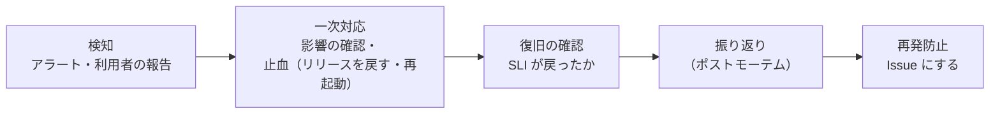

# ログ・監視の運用方針

このアプリのログの出し方、監視とアラート、障害が起きたときの動き方を決める。[非機能要件](./non-functional-requirements.md)・[インフラ構成](./infrastructure.md)の詳細ドキュメント。

> AWS への構築は未定（[インフラ構成](./infrastructure.md)）。この方針は、**どの道具を使っても変わらない部分**（何を測り、何を記録し、いつ人が動くか）を先に決めておくもの。道具（CloudWatch・Datadog）は「7. 道具と段階」で選ぶ。アプリ側の準備（段階 1）は実装済み（「7.2 段階 1 の実装」）。

## 1. 目的と範囲

監視とログの目的は次の3つ。何かを記録・監視するときは、どの目的のためかを書く。

| 目的 | 内容 | 主に使うデータ |
|---|---|---|
| **気づく** | 利用者が困っていることに、利用者より先に気づく | メトリクス（アラート） |
| **原因を追う** | 何が・いつ・どこで・誰に起きたかを、あとから調べられる | ログ・トレース |
| **傾向を見る** | 遅くなってきた・容量が埋まりそう、を壊れる前に知る | メトリクス（ダッシュボード） |

対象：バックエンド（Spring Boot）、フロントエンド（nginx・ブラウザ）、ALB・RDS・S3・CloudFront。

### 3つのデータの役割

| 種類 | 中身 | 役割 |
|---|---|---|
| メトリクス | 数値の時系列（5xx の割合・応答時間・CPU） | 「今おかしいか」を判断する。**アラートはメトリクスで鳴らす** |
| ログ | 出来事の記録（例外・ログイン・削除） | 「何が起きたか」を調べる。件数の傾向は、ログから作った数値で見る |
| トレース | 1つのリクエストが通った経路と、それぞれの時間 | 「どこで遅いか」を調べる（7章の段階 3） |

### 「症状」で鳴らし、「原因」で調べる

- **アラートにするのは、利用者に見える症状**：つながらない・エラーが増えた・遅い
- **原因（CPU・接続数など）はダッシュボードで見る**。CPU が高くても利用者が困っていなければ、人を呼ばない
- アラートが多すぎると、本当の障害を見逃す（オオカミ少年になる）。**鳴ったら人が何をするかを書けないものは、アラートにしない**

## 2. 守るもの（SLI・SLO）

[非機能要件](./non-functional-requirements.md)のとおり、利用者に約束する SLA は定義しない。ここで決める SLO は、**自分たちの判断に使う目標**（アラートの条件、安定化を優先するかの判断）で、外には約束しない。

| SLI（何を測るか） | SLO（目標） | 測り方 |
|---|---|---|
| 可用性：API のリクエストのうち、5xx で返らなかった割合 | 30日間で **99.5%** | ALB の状態コード別の件数（`/api/health` は除く） |
| 応答時間：API が 1秒以内に返った割合 | 30日間で **95%** | ALB の応答時間。目安は非機能要件の「操作から画面反映まで1秒以内」 |
| 外から使えるか：ログイン → タイムライン表示が成功した割合 | 30日間で **99.5%** | 外形監視（7章の段階 2 以降） |

- **エラーバジェット**：99.5% なら、30日で約3.6時間分の失敗は許される。使い切りそうなら、新しい機能より安定化（原因の修正・監視の追加）を優先する
- 学習目的の一時的な稼働では、目標を下回っても罰はない。**下回ったときに原因を説明できること**を大事にする

## 3. ログの設計

### 3.1 ログの種類

| 種類 | 目的 | 出すもの | 出す場所 |
|---|---|---|---|
| アプリのログ | 原因を追う | 想定外の例外、外部（S3・DB）の失敗、定期処理の結果 | バックエンド |
| アクセスログ | 原因を追う・傾向を見る | 1リクエスト1行：メソッド・パス・状態コード・時間・エラーコード・ユーザー ID | バックエンド（ALB のアクセスログでも補う） |
| 監査ログ | 「誰が何をしたか」の証跡 | 新規登録・ログイン・ログアウト・投稿とコメントの削除・プロフィールの変更 | バックエンド |
| セキュリティのログ | 攻撃・不正に気づく | ログインの失敗、リフレッシュトークンの使い回しの検知（`RefreshTokenService`）、権限のない操作（403） | バックエンド |

### 3.2 形式：構造化ログ（JSON）

本番では、1行1つの JSON で出す。文章のログ（`画像を保存できませんでした: abc.png`）は人には読みやすいが、「この1時間の S3 の失敗の件数」を数えにくいため。ローカル開発では、読みやすい今のテキストのままにする。

```json
{"@timestamp":"2026-10-24T02:50:46.011Z","log":{"level":"INFO","logger":"com.okimoto.sns.backend.logging.RequestLoggingFilter"},
 "service":{"name":"sns-backend","environment":"production","version":"a1b2c3d"},
 "message":"POST /api/auth/login 401 154ms","request_id":"Root=1-6719a3b5-abcdef0123456789abcdef01",
 "error_code":"INVALID_CREDENTIALS","http":{"method":"POST","status":401},"url":{"path":"/api/auth/login"},
 "duration_ms":154,"ecs":{"version":"8.11"}}
```

Spring Boot の標準の機能（`logging.structured.format.console: ecs`）を、本番の設定（`application-production.yml`）でだけ有効にする。項目名は ECS（Elastic Common Schema）の名前に合わせ（`http.method` などは入れ子の形で出る）、このアプリ独自の項目（`request_id`・`user_id`・`error_code`・`duration_ms`）を足す。上の例は、実際にアクセスログを ECS で出したもの（ログインの失敗）。

### 3.3 必ず入れる項目

| 項目 | 内容 | 理由 |
|---|---|---|
| 時刻 | UTC・ISO 8601・ミリ秒まで | サーバーや道具が違っても並べられる |
| レベル | 3.4 の基準 | 絞り込み・アラート |
| サービス・環境・バージョン | `sns-backend`・`production`・リリースの版 | 「今回のリリースから増えた」が分かる |
| **リクエスト ID** | 1つのリクエストのログに共通の番号。ALB が付ける `X-Amzn-Trace-Id` があればそれを使い、なければ作る。応答のヘッダーにも返す | 1つのリクエストのログをまとめて追える。ALB のアクセスログともつながる |
| ユーザー ID | ログイン中なら | 「この人だけ失敗する」が分かる。メールアドレスではなく ID を出す |
| エラーコード | `ErrorCode`（`IMAGE_UPLOAD_FAILED` など） | 画面の分岐と同じ名前で数えられる |

### 3.4 レベルの基準

| レベル | 基準 | 例 | 人が動くか |
|---|---|---|---|
| ERROR | 想定外の失敗で、利用者の操作が失敗した（5xx） | DB につながらない、S3 に保存できない、想定外の例外 | 調べる（件数によってはアラート） |
| WARN | 失敗したが利用者への影響はない、または自動で回復した。不正の疑い | S3 の画像を消せなかった（投稿の削除は成功）、トークンの使い回しの検知 | 傾向を見る・見直す |
| INFO | 大事な出来事 | 起動・停止、アクセスログ、監査ログ、定期処理の結果 | 調べるときに見る |
| DEBUG | 開発中だけ必要な詳細 | SQL・リクエストの中身 | 本番では出さない |

- **利用者の操作として想定内の失敗（4xx）は ERROR にしない**。入力チェックのエラー（400）・見つからない（404）・パスワード違い（401）を ERROR にすると、本物の障害が埋もれる。件数はアクセスログで数える
- 今のコードは、5xx だけを ERROR にしている（`GlobalExceptionHandler`・`ApiErrorController`・`ImageStorage`）。この基準に合っている

### 3.5 出さない情報

| 出さない | 代わりに |
|---|---|
| パスワード（平文・ハッシュとも） | 何も出さない（[非機能要件](./non-functional-requirements.md)「ログにも出さない」） |
| アクセストークン・リフレッシュトークン・Cookie・`Authorization` ヘッダー | 何も出さない |
| メールアドレス | ユーザー ID。ログインの失敗など ID がないときは、`a***@example.com` のように一部を隠す |
| 投稿・コメント・自己紹介の本文 | 投稿 ID・コメント ID |
| リクエスト・レスポンスの本文 | エラーコード・項目名（入力チェックのエラーは項目名だけ） |

- 実装するときは、**出さないことをテストで確かめる**（ログを取り込んで、パスワード・トークンの文字列が含まれないこと）
- 道具の側でも、秘密情報の形（JWT など）を見つけて隠す機能があれば有効にする（保険。これに頼らない）

## 4. 集める・残す

### 4.1 集め方

- アプリは**標準出力に出すだけ**にし、集めて送るのはサーバーに置くエージェント（CloudWatch エージェント・Datadog Agent）に任せる。アプリから監視サービスへ直接送ると、送り先の障害や遅れがアプリに響くため
- EC2 では systemd で動かしているので、標準出力は journald に入る。エージェントはそこから読む
- ALB のアクセスログは S3 に出す（ALB の設定）

### 4.2 残す期間

| ログ | すぐ検索できる期間 | 長期保存（S3） | 理由 |
|---|---|---|---|
| アプリ・アクセスログ | 14日 | 90日 | 障害の調査は2週間以内がほとんど。傾向はログから作った数値で長く残す |
| 監査・セキュリティのログ | 90日 | 1年 | 不正に気づくのが遅れることがある |
| ALB のアクセスログ | （S3 を直接検索） | 90日 | 量が多い。必要なときだけ Athena で調べる |

学習目的で環境ごと消すとき（`terraform destroy`）は、ログも一緒に消えてよい。

### 4.3 費用の考え方

ログの費用は「量 × 残す期間」で増える。次の順で量を抑える。

1. **出さない**：DEBUG は本番で出さない。ALB のヘルスチェック（`/api/health`）はアクセスログに出さない
2. **数値にしてから捨てる**：件数の傾向・アラートに使うもの（ステータス別の件数など）は、ログから数値を作り、ログそのものは短く残す
3. **安い場所へ移す**：長期保存は S3 に置き、検索したいときだけ戻す

## 5. 監視とアラート

### 5.1 緊急度

| 緊急度 | 意味 | 通知 | 対応 |
|---|---|---|---|
| **P1** | 利用者の多くが使えない | すぐ気づける手段（スマホへの通知） | すぐ対応する |
| **P2** | 一部が失敗している・遅い・放っておくと P1 になる | Slack・メール | その日のうちに対応する |
| **P3** | すぐの影響はない。見直しが必要 | 記録だけ（週に1回まとめて見る） | 見直しのときに対応する |

### 5.2 監視項目

| # | 監視する内容 | データの元 | 条件 | 緊急度 | 最初に見るもの |
|---|---|---|---|---|---|
| A1 | 外からつながるか | 外形監視（ログイン → タイムライン） | 2回続けて失敗 | P1 | ALB のターゲットの状態、バックエンドの起動ログ |
| A2 | API の 5xx の割合 | ALB のメトリクス | 5分間で 5% を超える | P1 | ERROR のログ（エラーコード別の件数） |
| A3 | DB につながらない | ログ（`SERVICE_UNAVAILABLE`） | 5分間に3件以上 | P1 | RDS の状態・接続数 |
| A4 | API の応答時間 | ALB のメトリクス（p95） | 10分間 1秒を超える | P2 | 遅いパス（アクセスログの `duration_ms`）、RDS の CPU |
| A5 | 画像を保存できない | ログ（`IMAGE_UPLOAD_FAILED`） | 10分間に5件以上 | P2 | S3 の状態、IAM ロールの権限 |
| A6 | ログインの失敗の急増 | 監査ログ（401 `INVALID_CREDENTIALS`） | 10分間で普段の5倍以上 | P2 | 同じ IP・同じメールアドレスへの集中（総当たり攻撃の疑い） |
| A7 | リフレッシュトークンの使い回しの検知 | セキュリティのログ | 1件でも | P3 | そのユーザーのログイン履歴 |
| A8 | RDS の空き容量 | CloudWatch | 20% を下回る | P2 | テーブルの大きさ |
| A9 | EC2 のディスク・メモリ | エージェント | ディスク 80%・メモリ 90% を超える | P2 | ログの量、Java のヒープ |
| A10 | 監視のデータが届かない | 監視の道具（No Data） | 15分間届かない | P2 | エージェントが動いているか |

- 一瞬の山では鳴らさないよう、「◯分間続いたら」と時間の幅を持たせる
- **A10 は必須**：エージェントが止まると、障害があっても「静か」に見えるため

### 5.3 アラートの書き方

アラート1つごとに、通知の本文に次を書く。

1. 何が起きているか（条件と今の値）
2. 利用者への影響
3. 最初に見るダッシュボード・ログの検索条件
4. 手順書（Runbook）へのリンク：確かめること・戻し方（直前のリリースに戻す、サーバーを再起動する など）

### 5.4 ダッシュボード

| 名前 | 見る人・場面 | 中身 |
|---|---|---|
| サービスの概要 | 毎日・障害のとき最初に | SLO の残り、リクエスト数、5xx の割合、応答時間（p50・p95・p99） |
| インフラ | 原因を探すとき | EC2（CPU・メモリ・ディスク）、RDS（CPU・接続数・空き容量）、ALB のターゲットの状態 |
| 調べる | 原因を探すとき | パス別の件数と応答時間、エラーコード別の件数、ログインの成功・失敗 |

## 6. 障害が起きたとき



- **止血を先にする**：原因を探すより先に、利用者が使える状態に戻す（直前のリリースに戻すのが一番早い）
- **振り返り**：P1・P2 は、何が起きたか・なぜ気づけた（気づけなかった）か・どう直すかを、人を責めずに書く。「気づけなかった」「調べられなかった」なら、ログ・アラートを足す
- 再発防止は Issue にして、ほかの作業と同じ流れ（[CLAUDE.md](../CLAUDE.md)）で直す。不具合の修正は、再現するテストを先に書く

## 7. 道具と段階

方針（2〜6章）は道具に依存しない。費用と必要に合わせて、段階的に広げる。

| 段階 | いつ | やること | 道具 |
|---|---|---|---|
| **1. アプリの準備** | 実装済み（7.2） | 構造化ログ、リクエスト ID、アクセスログ・監査ログ・セキュリティのログ、出さない情報のテスト | Spring Boot の標準の機能 |
| **2. AWS の標準で監視** | AWS に構築するとき | 4章の収集・保存、5章の監視項目とダッシュボード、外形監視 | CloudWatch Logs・Alarms・Dashboards・Synthetics（Canary）、SNS で通知、ALB のアクセスログ → S3・Athena |
| **3. 監視サービス** | サービスが増える・チームで見る・トレースで横断して追いたくなったとき | 段階 2 に加え、トレース・フロントの監視 | Datadog（7.1） |

学習目的の一時的な稼働では、段階 2 までで十分。費用が少なく、Terraform で環境と一緒に作って消せる。

### 7.1 Datadog を使う場合

| 機能 | 使い方 |
|---|---|
| Datadog Agent | EC2（フロント・バックエンド）に入れ、メトリクスとログを集める |
| AWS 連携 | ALB・RDS・S3・CloudFront のメトリクスを取り込む |
| APM（`dd-java-agent`） | Spring Boot の起動時に Java エージェントを付けて、トレースを取る。ログに `trace_id` が入り、トレースとログを行き来できる |
| Log Management | 構造化ログを取り込む。3章の項目名を、Datadog の標準の項目に対応付ける（パイプライン） |
| Monitors | 5.2 の監視項目を、メトリクス・ログ・APM の条件で作る。通知先は `@slack-…` などで緊急度ごとに分ける |
| SLO | 2章の SLO を登録し、エラーバジェットの残りを見る |
| Synthetics | A1 の外形監視（ログイン → タイムライン） |
| RUM | ブラウザでの表示の速さ・JavaScript のエラー（React の画面） |
| Sensitive Data Scanner | 3.5 の秘密情報が漏れていないかの保険 |

**最初に決めること**

- **タグ（Unified Service Tagging）**：すべてのデータに `env`（production など）・`service`（`sns-backend`・`sns-frontend`）・`version` を付ける。メトリクス・ログ・トレースを同じ名前で横断して見るため。あとから直すのが大変なので、最初に決める
- **ログの費用**：Datadog のログは、取り込んだ量と、検索できるように残した（インデックスした）件数で費用がかかる。4.3 の考え方を、次のように当てはめる
  - 全部取り込み、件数の傾向・アラートは**ログから作った数値（Log-based Metrics）**で見る
  - **インデックスは絞る**：ERROR・WARN・監査・セキュリティのログは残す。INFO のアクセスログは一部だけ、ヘルスチェックは**除外フィルター**で捨てる
  - 全量を **S3 にアーカイブ**し、必要なときだけ呼び戻して（Rehydrate）検索する
- **Monitor の本文**：5.3 のとおり、影響・最初に見るもの・Runbook を書く

### 7.2 段階 1 の実装

| 内容 | 場所 | テスト |
|---|---|---|
| リクエスト ID（`X-Amzn-Trace-Id` を使う・なければ作る、応答の `X-Request-Id`）、アクセスログ | `logging/RequestLoggingFilter` | `RequestLoggingTest` |
| MDC の項目（`request_id`・`user_id`・`error_code`） | `logging/LogFields`（ユーザー ID は `JwtAuthenticationFilter`、エラーコードはエラーの応答を作る3か所で入れる） | `RequestLoggingTest` |
| 監査ログ・セキュリティのログ | `logging/AuditLog`（各 Service から呼ぶ） | `AuditLogTest` |
| 本番だけ JSON（ECS）で出す、サービス名・環境・バージョン | `application-production.yml`（バージョンは環境変数 `APP_VERSION`） | `ProductionLoggingConfigTest` |

監査ログ・セキュリティのログの `event.action`：

| `event.action` | レベル | いつ | 主な項目 |
|---|---|---|---|
| `signup` | INFO | 新規登録した | `user_id` |
| `login` | INFO | ログインした | `user_id` |
| `login_failed` | WARN | ログインに失敗した（パスワード違い・登録されていない） | `user.email`（一部を隠す） |
| `logout` | INFO | ログアウトした | `user_id` |
| `refresh_token_reuse` | WARN | 使用済みのリフレッシュトークンが使われ、そのユーザーのトークンをすべて無効にした | `user_id` |
| `post_delete` | INFO | 投稿を削除した | `user_id`・`post.id` |
| `comment_delete` | INFO | コメントを削除した | `user_id`・`comment.id` |
| `profile_update` | INFO | プロフィールを変更した | `user_id` |
| `forbidden` | WARN | 権限のない操作（403） | `user_id` |

- テストは、出力の文字列ではなくログの中身（レベル・MDC・キーと値）を受け取って確かめる（`support/LogCapture`）。出力の形式（テキスト・JSON）に左右されない
- 登録からログアウトまでの間に、パスワード・トークン・メールアドレス・投稿の本文・検索のキーワードがどのログにも出ないことを確かめている

## 8. 見直し

| いつ | 何を見るか |
|---|---|
| 毎週（稼働している間） | P3 の記録、SLO の残り |
| 毎月 | 鳴ったのに何もしなかったアラート（消す・緩める）、ログの量と費用 |
| 障害のあと | 気づけたか・調べられたか。足りなければログ・アラートを足す |
| 機能を足したとき | 新しいエラーコード・外部の呼び出しに、ログと監視項目が要るか |
