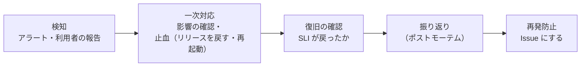

# ログ・監視の運用方針

このアプリのログの出し方、監視とアラート、障害が起きたときの動き方を決める。[非機能要件](./non-functional-requirements.md)・[インフラ構成](./infrastructure.md)の詳細ドキュメント。

> この方針は、**どの道具を使っても変わらない部分**（何を測り、何を記録し、いつ人が動くか）を先に決めておくもの。道具（CloudWatch・Datadog）は「7. 道具と段階」で選ぶ。アプリ側の準備（段階 1）は実装済み（「7.2 段階 1 の実装」）。AWS の標準の監視（段階 2）は、アラームと通知を実装した（「7.5 段階 2 の実装」）。

## 1. 目的と範囲

監視とログの目的は次の3つ。何かを記録・監視するときは、どの目的のためかを書く。

| 目的 | 内容 | 主に使うデータ |
|---|---|---|
| **気づく** | 利用者が困っていることに、利用者より先に気づく | メトリクス（アラート） |
| **原因を追う** | 何が・いつ・どこで・誰に起きたかを、あとから調べられる | ログ・トレース |
| **傾向を見る** | 遅くなってきた・容量が埋まりそう、を壊れる前に知る | メトリクス（ダッシュボード） |

対象：バックエンド（Spring Boot。ECS Fargate）、フロントエンド（ブラウザ）、ALB・RDS・S3・CloudFront。

### 3つのデータの役割

| 種類 | 中身 | 役割 |
|---|---|---|
| メトリクス | 数値の時系列（5xx の割合・応答時間・CPU） | 「今おかしいか」を判断する。**アラートはメトリクスで鳴らす** |
| ログ | 出来事の記録（例外・ログイン・削除） | 「何が起きたか」を調べる。件数の傾向は、ログから作った数値で見る |
| トレース | 1つのリクエストが通った経路と、それぞれの時間 | 「どこで遅いか」を調べる（7章の段階 3） |

### 「症状」で鳴らし、「原因」で調べる

- **アラートにするのは、利用者に見える症状**：つながらない・エラーが増えた・遅い
- **原因（CPU・接続数など）はダッシュボードで見る**。CPU が高くても利用者が困っていなければ、人を呼ばない
- アラートが多すぎると、本当の障害を見逃す（オオカミ少年になる）。**鳴ったら人が何をするかを書けないものは、アラートにしない**

## 2. 守るもの（SLI・SLO）

[非機能要件](./non-functional-requirements.md)のとおり、利用者に約束する SLA は定義しない。ここで決める SLO は、**自分たちの判断に使う目標**（アラートの条件、安定化を優先するかの判断）で、外には約束しない。

| SLI（何を測るか） | SLO（目標） | 測り方 |
|---|---|---|
| 可用性：API のリクエストのうち、5xx で返らなかった割合 | 30日間で **99.5%** | ALB の状態コード別の件数（`/api/health` は除く） |
| 応答時間：API が 1秒以内に返った割合 | 30日間で **95%** | ALB の応答時間。目安は非機能要件の「操作から画面反映まで1秒以内」 |
| 外から使えるか：ログイン → タイムライン表示が成功した割合 | 30日間で **99.5%** | 外形監視（7章の段階 2 以降） |

- **エラーバジェット**：99.5% なら、30日で約3.6時間分の失敗は許される。使い切りそうなら、新しい機能より安定化（原因の修正・監視の追加）を優先する
- 学習目的の一時的な稼働では、目標を下回っても罰はない。**下回ったときに原因を説明できること**を大事にする

## 3. ログの設計

### 3.1 ログの種類

| 種類 | 目的 | 出すもの | 出す場所 |
|---|---|---|---|
| アプリのログ | 原因を追う | 想定外の例外、外部（S3・DB）の失敗、定期処理の結果 | バックエンド |
| アクセスログ | 原因を追う・傾向を見る | 1リクエスト1行：メソッド・パス・状態コード・時間・エラーコード・ユーザー ID | バックエンド（ALB のアクセスログでも補う） |
| 監査ログ | 「誰が何をしたか」の証跡 | 新規登録・ログイン・ログアウト・投稿とコメントの削除・プロフィールの変更 | バックエンド |
| セキュリティのログ | 攻撃・不正に気づく | ログインの失敗、リフレッシュトークンの使い回しの検知（`RefreshTokenService`）、権限のない操作（403）、正しくないアクセストークン | バックエンド |
| 画面のエラー | 画面の不具合に気づく・原因を追う | 画面の表示中のエラー、捕まえ損ねた例外・Promise の失敗（文言・スタックトレース・画面のパス・ブラウザ）。通信エラーとほかのサイトのスクリプト（ブラウザ拡張など）のエラーは送らない | 画面が `POST /api/client-errors`（A-90）で送り、バックエンドが出す |

### 3.2 形式：構造化ログ（JSON）

本番では、1行1つの JSON で出す。文章のログ（`画像を保存できませんでした: abc.png`）は人には読みやすいが、「この1時間の S3 の失敗の件数」を数えにくいため。ローカル開発では、読みやすい今のテキストのままにする。

```json
{"@timestamp":"2026-10-24T02:50:46.011Z","log":{"level":"INFO","logger":"com.okimoto.sns.backend.logging.RequestLoggingFilter"},
 "service":{"name":"sns-backend","environment":"production","version":"a1b2c3d"},
 "message":"POST /api/auth/login 401 154ms","request_id":"Root=1-6719a3b5-abcdef0123456789abcdef01",
 "error_code":"INVALID_CREDENTIALS","http":{"method":"POST","status":401},"url":{"path":"/api/auth/login"},
 "duration_ms":154,"ecs":{"version":"8.11"}}
```

Spring Boot の標準の機能（`logging.structured.format.console: ecs`）を、本番の設定（`application-production.yml`）でだけ有効にする。項目名は ECS（Elastic Common Schema）の名前に合わせ（`http.method` などは入れ子の形で出る）、このアプリ独自の項目（`request_id`・`user_id`・`error_code`・`duration_ms`）を足す。上の例は、実際にアクセスログを ECS で出したもの（ログインの失敗）。

### 3.3 必ず入れる項目

| 項目 | 内容 | 理由 |
|---|---|---|
| 時刻 | UTC・ISO 8601・ミリ秒まで | サーバーや道具が違っても並べられる |
| レベル | 3.4 の基準 | 絞り込み・アラート |
| サービス・環境・バージョン | `sns-backend`・`production`・リリースの版 | 「今回のリリースから増えた」が分かる |
| **リクエスト ID** | 1つのリクエストのログに共通の番号。ALB が付ける `X-Amzn-Trace-Id` があればそれを使い、なければ作る。応答のヘッダーにも返す | 1つのリクエストのログをまとめて追える。ALB のアクセスログともつながる |
| ユーザー ID | ログイン中なら | 「この人だけ失敗する」が分かる。メールアドレスではなく ID を出す |
| エラーコード | `ErrorCode`（`IMAGE_UPLOAD_FAILED` など） | 画面の分岐と同じ名前で数えられる |

### 3.4 レベルの基準

| レベル | 基準 | 例 | 人が動くか |
|---|---|---|---|
| ERROR | 想定外の失敗で、利用者の操作が失敗した（5xx） | DB につながらない、S3 に保存できない、想定外の例外 | 調べる（件数によってはアラート） |
| WARN | 失敗したが利用者への影響はない、または自動で回復した。不正の疑い | S3 の画像を消せなかった（投稿の削除は成功）、トークンの使い回しの検知 | 傾向を見る・見直す |
| INFO | 大事な出来事 | 起動・停止、アクセスログ、監査ログ、定期処理の結果 | 調べるときに見る |
| DEBUG | 開発中だけ必要な詳細 | SQL・リクエストの中身 | 本番では出さない |

- **利用者の操作として想定内の失敗（4xx）は ERROR にしない**。入力チェックのエラー（400）・見つからない（404）・パスワード違い（401）を ERROR にすると、本物の障害が埋もれる。件数はアクセスログで数える
- 今のコードは、5xx だけを ERROR にしている（`GlobalExceptionHandler`・`ApiErrorController`・`ImageStorage`）。この基準に合っている

### 3.5 出さない情報

| 出さない | 代わりに |
|---|---|
| パスワード（平文・ハッシュとも） | 何も出さない（[非機能要件](./non-functional-requirements.md)「ログにも出さない」） |
| アクセストークン・リフレッシュトークン・Cookie・`Authorization` ヘッダー | 何も出さない |
| メールアドレス | ユーザー ID。ログインの失敗など ID がないときは、`a***@example.com` のように一部を隠す |
| 投稿・コメント・自己紹介の本文 | 投稿 ID・コメント ID |
| リクエスト・レスポンスの本文 | エラーコード・項目名（入力チェックのエラーは項目名だけ） |

- 実装するときは、**出さないことをテストで確かめる**（ログを取り込んで、パスワード・トークンの文字列が含まれないこと）
- 道具の側でも、秘密情報の形（JWT など）を見つけて隠す機能があれば有効にする（保険。これに頼らない）

## 4. 集める・残す

### 4.1 集め方

- アプリは**標準出力に出すだけ**にし、集めて送るのは仕組みの側（ECS のログドライバー・Datadog Agent）に任せる。アプリから監視サービスへ直接送ると、送り先の障害や遅れがアプリに響くため
- API は ECS Fargate で動かしているので、標準出力は ECS のログドライバー（awslogs）が CloudWatch Logs（`/ecs/sns-app-backend`）に送る。エージェントを入れる必要はない（#155）
- ALB のアクセスログは S3 に出す（ALB の設定）

### 4.2 残す期間

| ログ | すぐ検索できる期間 | 長期保存（S3） | 理由 |
|---|---|---|---|
| アプリ・アクセスログ | 14日 | 90日 | 障害の調査は2週間以内がほとんど。傾向はログから作った数値で長く残す |
| 監査・セキュリティのログ | 90日 | 1年 | 不正に気づくのが遅れることがある |
| ALB のアクセスログ | （S3 を直接検索） | 90日 | 量が多い。必要なときだけ Athena で調べる |

学習目的で環境ごと消すとき（`terraform destroy`）は、ログも一緒に消えてよい。

### 4.3 費用の考え方

ログの費用は「量 × 残す期間」で増える。次の順で量を抑える。

1. **出さない**：DEBUG は本番で出さない。ALB のヘルスチェック（`/api/health`）はアクセスログに出さない
2. **数値にしてから捨てる**：件数の傾向・アラートに使うもの（ステータス別の件数など）は、ログから数値を作り、ログそのものは短く残す
3. **安い場所へ移す**：長期保存は S3 に置き、検索したいときだけ戻す

## 5. 監視とアラート

### 5.1 緊急度

| 緊急度 | 意味 | 通知 | 対応 |
|---|---|---|---|
| **P1** | 利用者の多くが使えない | すぐ気づける手段（スマホへの通知） | すぐ対応する |
| **P2** | 一部が失敗している・遅い・放っておくと P1 になる | Slack・メール | その日のうちに対応する |
| **P3** | すぐの影響はない。見直しが必要 | 記録だけ（週に1回まとめて見る） | 見直しのときに対応する |

### 5.2 監視項目

| # | 監視する内容 | データの元 | 条件 | 緊急度 | 最初に見るもの |
|---|---|---|---|---|---|
| A1 | 外からつながるか | 外形監視（ログイン → タイムライン） | 2回続けて失敗 | P1 | ALB のターゲットの状態、バックエンドの起動ログ |
| A2 | API の 5xx の割合 | ALB のメトリクス | 5分間で 5% を超える | P1 | ERROR のログ（エラーコード別の件数） |
| A3 | DB につながらない | ログ（`SERVICE_UNAVAILABLE`） | 5分間に3件以上 | P1 | RDS の状態・接続数 |
| A4 | API の応答時間 | ALB のメトリクス（p95） | 10分間 1秒を超える | P2 | 遅いパス（アクセスログの `duration_ms`）、RDS の CPU |
| A5 | 画像を保存できない | ログ（`IMAGE_UPLOAD_FAILED`） | 10分間に5件以上 | P2 | S3 の状態、IAM ロールの権限 |
| A6 | ログインの失敗の急増 | 監査ログ（401 `INVALID_CREDENTIALS`） | 10分間で普段の5倍以上 | P2 | 同じ IP・同じメールアドレスへの集中（総当たり攻撃の疑い） |
| A7 | リフレッシュトークンの使い回しの検知 | セキュリティのログ | 1件でも | P3 | そのユーザーのログイン履歴 |
| A8 | RDS の空き容量 | CloudWatch | 20% を下回る | P2 | テーブルの大きさ |
| A9 | API のタスクの CPU・メモリ | ECS のメトリクス（CloudWatch） | CPU 80%・メモリ 90% を超える | P2 | Java のヒープ、タスクが入れ替わっていないか（メモリが足りないと止まって作り直される） |
| A10 | 監視のデータが届かない | 監視の道具（No Data） | 15分間届かない | P2 | エージェントが動いているか |
| A11 | 正しくないアクセストークンの急増 | セキュリティのログ（`invalid_token`） | 10分間に20件以上 | P3 | 同じ IP からの集中（偽造・総当たりの疑い）。期限切れは数えない |
| A12 | 画面のエラーの急増 | 画面のエラー（`client_error`） | 1時間に、普段の3倍以上、または新しい文言のエラー | P2 | 文言・画面のパス別の件数、直前のリリース（`service.version`）。誰でも送れるので、同じ IP からの大量の報告は偽物を疑う |

- 一瞬の山では鳴らさないよう、「◯分間続いたら」と時間の幅を持たせる
- **A10 は必須**：エージェントが止まると、障害があっても「静か」に見えるため

### 5.3 アラートの書き方

アラート1つごとに、通知の本文に次を書く。

1. 何が起きているか（条件と今の値）
2. 利用者への影響
3. 最初に見るダッシュボード・ログの検索条件
4. 手順書（Runbook）へのリンク：確かめること・戻し方（直前のリリースに戻す、サーバーを再起動する など）

### 5.4 ダッシュボード

| 名前 | 見る人・場面 | 中身 |
|---|---|---|
| サービスの概要 | 毎日・障害のとき最初に | SLO の残り、リクエスト数、5xx の割合、応答時間（p50・p95・p99） |
| インフラ | 原因を探すとき | API のタスク（CPU・メモリ・動いている数）、RDS（CPU・接続数・空き容量）、ALB のターゲットの状態 |
| 調べる | 原因を探すとき | パス別の件数と応答時間、エラーコード別の件数、ログインの成功・失敗 |

## 6. 障害が起きたとき



- **止血を先にする**：原因を探すより先に、利用者が使える状態に戻す（直前のリリースに戻すのが一番早い）
- **振り返り**：P1・P2 は、何が起きたか・なぜ気づけた（気づけなかった）か・どう直すかを、人を責めずに書く。「気づけなかった」「調べられなかった」なら、ログ・アラートを足す
- 再発防止は Issue にして、ほかの作業と同じ流れ（[CLAUDE.md](../CLAUDE.md)）で直す。不具合の修正は、再現するテストを先に書く

## 7. 道具と段階

方針（2〜6章）は道具に依存しない。費用と必要に合わせて、段階的に広げる。

| 段階 | いつ | やること | 道具 |
|---|---|---|---|
| **1. アプリの準備** | 実装済み（7.2） | 構造化ログ、リクエスト ID、アクセスログ・監査ログ・セキュリティのログ、出さない情報のテスト | Spring Boot の標準の機能 |
| **2. AWS の標準で監視** | 一部を実装済み（7.5。ログの収集・アラーム・メールの通知）。ダッシュボード・外形監視・ALB のアクセスログは未対応（[インフラ構成](./infrastructure.md)「今後の課題」） | 4章の収集・保存、5章の監視項目とダッシュボード、外形監視 | CloudWatch Logs・Alarms・Dashboards・Synthetics（Canary）、SNS で通知、ALB のアクセスログ → S3・Athena |
| **3. 監視サービス** | サービスが増える・チームで見る・トレースで横断して追いたくなったとき | 段階 2 に加え、トレース・フロントの監視（表示の速さ。エラーは段階 1 で自前で送っている。RUM に置き換えてもよい） | Datadog（7.1） |

学習目的の一時的な稼働では、段階 2 までで十分。費用が少なく、Terraform で環境と一緒に作って消せる。

### 7.1 Datadog を使う場合

| 機能 | 使い方 |
|---|---|
| Datadog Agent | API のタスクにサイドカー（2つ目のコンテナ）として入れ、メトリクスとトレースを集める |
| AWS 連携 | ALB・RDS・S3・CloudFront のメトリクスを取り込む |
| APM（`dd-java-agent`） | Spring Boot の起動時に Java エージェントを付けて、トレースを取る。ログに `trace_id` が入り、トレースとログを行き来できる |
| Log Management | 構造化ログを取り込む。3章の項目名を、Datadog の標準の項目に対応付ける（パイプライン） |
| Monitors | 5.2 の監視項目を、メトリクス・ログ・APM の条件で作る。通知先は `@slack-…` などで緊急度ごとに分ける |
| SLO | 2章の SLO を登録し、エラーバジェットの残りを見る |
| Synthetics | A1 の外形監視（ログイン → タイムライン） |
| RUM | ブラウザでの表示の速さ・JavaScript のエラー（React の画面） |
| Sensitive Data Scanner | 3.5 の秘密情報が漏れていないかの保険 |

**最初に決めること**

- **タグ（Unified Service Tagging）**：すべてのデータに `env`（production など）・`service`（`sns-backend`・`sns-frontend`）・`version` を付ける。メトリクス・ログ・トレースを同じ名前で横断して見るため。あとから直すのが大変なので、最初に決める
- **ログの費用**：Datadog のログは、取り込んだ量と、検索できるように残した（インデックスした）件数で費用がかかる。4.3 の考え方を、次のように当てはめる
  - 全部取り込み、件数の傾向・アラートは**ログから作った数値（Log-based Metrics）**で見る
  - **インデックスは絞る**：ERROR・WARN・監査・セキュリティのログは残す。INFO のアクセスログは一部だけ、ヘルスチェックは**除外フィルター**で捨てる
  - 全量を **S3 にアーカイブ**し、必要なときだけ呼び戻して（Rehydrate）検索する
- **Monitor の本文**：5.3 のとおり、影響・最初に見るもの・Runbook を書く

### 7.2 段階 1 の実装

| 内容 | 場所 | テスト |
|---|---|---|
| リクエスト ID（`X-Amzn-Trace-Id` を使う・なければ作る、応答の `X-Request-Id`）、アクセスログ | `logging/RequestLoggingFilter` | `RequestLoggingTest` |
| MDC の項目（`request_id`・`user_id`・`error_code`） | `logging/LogFields`（ユーザー ID は `JwtAuthenticationFilter`、エラーコードはエラーの応答を作る3か所で入れる） | `RequestLoggingTest` |
| 監査ログ・セキュリティのログ | `logging/AuditLog`（各 Service と `JwtService` から呼ぶ） | `AuditLogTest`・`JwtServiceTest` |
| 画面のエラー（受け取る側）：A-90、ログインなしで送れる、長さの上限、検索条件を切る | `logging/ClientErrorController`・`ClientErrorReport` | `ClientErrorTest` |
| 画面のエラー（送る側）：拾う・送らないもの・同じものは1回・1回のページ表示で10件まで | `frontend/src/lib/errorReporting.ts`（起動は `main.tsx`）、送信は `api/client.ts` の `reportClientError` | `errorReporting.test.ts`・`client.test.ts` |
| 画面の表示中のエラー：真っ白な画面の代わりに「問題が発生しました」と再読み込み | `frontend/src/pages/ErrorPage.tsx`（`router.tsx` の `errorElement`） | `ErrorPage.test.tsx`、E2E の `client-error.spec.ts` |
| 本番だけ JSON（ECS）で出す、サービス名・環境・バージョン | `application-production.yml`（バージョンは環境変数 `APP_VERSION`） | `ProductionLoggingConfigTest` |

監査ログ・セキュリティのログの `event.action`：

| `event.action` | レベル | いつ | 主な項目 |
|---|---|---|---|
| `signup` | INFO | 新規登録した | `user_id` |
| `login` | INFO | ログインした | `user_id` |
| `login_failed` | WARN | ログインに失敗した（パスワード違い・登録されていない） | `user.email`（一部を隠す） |
| `login_locked` | WARN | ログインの失敗が続いたので、そのメールアドレスのログインをロックした（[認証の機能仕様](./feature-specs/01_auth.md)「ログインの試行回数の制限」）。ロック中の 429 は記録しない | `user.email`（一部を隠す） |
| `logout` | INFO | ログアウトした | `user_id` |
| `refresh_token_reuse` | WARN | 使用済みのリフレッシュトークンが使われ、そのユーザーのトークンをすべて無効にした | `user_id` |
| `post_delete` | INFO | 投稿を削除した | `user_id`・`post.id` |
| `comment_delete` | INFO | コメントを削除した | `user_id`・`comment.id` |
| `profile_update` | INFO | プロフィールを変更した | `user_id` |
| `forbidden` | WARN | 権限のない操作（403） | `user_id` |
| `client_error` | WARN | 画面で起きたエラーの報告。誰でも送れるので、偽物を大量に送られても P1 が鳴らないよう ERROR にしない | `error.type`（`render`・`error`・`unhandledrejection`）・`error.message`・`error.stack_trace`・`url.path`・`user_agent.original` |
| `invalid_token` | WARN | アクセストークンの署名が合わない（`reason`=`signature_invalid`）・形がおかしい（`malformed`）。**期限切れは出さない**（画面が自動で再発行するふつうのことなので）。トークンそのものは出さない | `reason` |

- テストは、出力の文字列ではなくログの中身（レベル・MDC・キーと値）を受け取って確かめる（`support/LogCapture`）。出力の形式（テキスト・JSON）に左右されない
- 登録からログアウトまでの間に、パスワード・トークン・メールアドレス・投稿の本文・検索のキーワードがどのログにも出ないことを確かめている

### 7.3 Datadog の導入手順

段階 3 に進むと決めたときの手順。API は ECS Fargate で動かす前提（[インフラ構成](./infrastructure.md)）。API キーなどの秘密情報はリポジトリに入れない。

**1. アカウントとキー**

- Datadog のアカウントを作り、サイトを選ぶ（日本なら AP1：`ap1.datadoghq.com`）。以降の `DD_SITE` はこの値
- API キー（Agent がデータを送るためのキー）を作る。SSM パラメータストア（SecureString）にだけ置き、タスク定義の `secrets` で Agent に渡す

**2. AWS 連携（ALB・RDS・S3・CloudFront のメトリクス）**

- Datadog の画面の Integrations → Amazon Web Services から、案内される CloudFormation で、Datadog が CloudWatch を読むための IAM ロールを作る
- 取り込むサービスを ALB・RDS・S3・CloudFront・ECS に絞る（取り込む量で費用が変わるため）

**3. Agent をタスクに入れる（Fargate のサイドカー）**

API は ECS Fargate で動かしている（[インフラ構成](./infrastructure.md)。サーバーに Agent を入れられない）ので、Agent を**同じタスクの中の2つ目のコンテナ（サイドカー）**として動かす。Terraform のタスク定義（`infra/ecs.tf`）の `container_definitions` に足す。

- イメージ：`public.ecr.aws/datadog/agent:latest`（版は固定する）
- 環境変数：`DD_SITE`・`ECS_FARGATE=true`・`DD_APM_ENABLED=true`。API キー（`DD_API_KEY`）は SSM パラメータストアに置き、`secrets` で渡す（DB のパスワードと同じ）
- タスクの CPU・メモリを、Agent の分（0.25 vCPU・512MB ほど）だけ増やす

**4. API のログを集める**

ログは今、awslogs ドライバーで CloudWatch Logs に送っている（「4.1 集め方」）。Datadog に送るには、次のどちらかにする。

- **FireLens**（タスクの中の Fluent Bit のコンテナ）で、ログを直接 Datadog に送る。タスク定義の `logConfiguration` を `awsfirelens` にする
- CloudWatch Logs に送ったまま、Datadog の Forwarder（Lambda）で取り込む。タスク定義は変えなくてよいが、Lambda の分の手間と費用がかかる

どちらでも、ログは JSON（ECS）なので、Datadog が項目ごとに読み取る（`@http.status`・`@error_code`・`@event.action` などで検索できる）。Logs → Pipelines で、レベル（`log.level`）と時刻（`@timestamp`）が Datadog のステータス・日時として読まれているかを確かめ、読まれていなければ Status Remapper・Date Remapper に指定する。

**5. APM（トレース）を付ける**

`backend/Dockerfile` で Java エージェント（`dd-java-agent.jar`）をイメージに入れ、起動コマンドに `-javaagent:` を付ける。タグ（Unified Service Tagging）はタスク定義の環境変数で渡す。

```text
DD_SERVICE=sns-backend
DD_ENV=production
DD_VERSION=<APP_VERSION と同じ値>   # deploy.sh がイメージに入れている版（git の短いハッシュ）
DD_LOGS_INJECTION=true
```

- `DD_LOGS_INJECTION=true` で、ログの MDC にトレース ID（`dd.trace_id`）が入る。ECS のログは MDC をそのまま項目にするので、Datadog でログとトレースを行き来できる
- `DD_VERSION` は、ログの `service.version` と同じ値（`APP_VERSION`）にする。リリースごとの比較がメトリクス・ログ・トレースでそろう

**6. 費用の設定（7.1「ログの費用」）**

| 設定 | 内容 |
|---|---|
| Index | 1つ（`main`）。残す日数は 15日（「4.2 残す期間」の14日に一番近い、Datadog で選べる日数）。監査・セキュリティのログ（`@event.action:*`）を長く残すなら、別の Index で 90日 |
| Exclusion Filter | 成功したアクセスログ（`@http.status:[200 TO 399] -@event.action:*`）は 10% だけ残す。ヘルスチェックはアプリが出さない |
| Log-based Metrics | `@http.status` 別の件数、`@error_code` 別の件数、`@event.action` 別の件数。アラートと傾向はこの数値で見る（15か月残る） |
| Archive | 全量を S3（ログ用のバケット）へ。調べたいときだけ Rehydrate で戻す |

**7. Monitor（「5.2 監視項目」を Datadog で作る）**

| # | 種類 | 条件の例 | 通知 |
|---|---|---|---|
| A1 | Synthetics（API テスト：ログイン → タイムライン） | 2か所から2回続けて失敗 | P1 |
| A2 | Metric | `sum:aws.applicationelb.httpcode_target_5xx{*}.as_count() / sum:aws.applicationelb.request_count{*}.as_count()` が 5分で 5% を超える | P1 |
| A3 | Log | `service:sns-backend @error_code:SERVICE_UNAVAILABLE` が 5分で3件以上 | P1 |
| A4 | Metric（APM） | `p95:trace.servlet.request{service:sns-backend}` が 10分 1秒を超える | P2 |
| A5 | Log | `@error_code:IMAGE_UPLOAD_FAILED` が 10分で5件以上 | P2 |
| A6 | Log（Anomaly） | `@event.action:login_failed` の件数が普段から大きく外れる | P2 |
| A7 | Log | `@event.action:refresh_token_reuse` が1件以上 | P3 |
| A8・A9 | Metric | RDS の `aws.rds.free_storage_space`、Agent の `system.disk.in_use`・`system.mem.pct_usable` | P2 |
| A10 | Service Check | `datadog.agent.up` が15分届かない | P2 |
| A11 | Log | `@event.action:invalid_token` が 10分で20件以上 | P3 |
| A12 | Log（Anomaly） | `@event.action:client_error` の件数が普段から大きく外れる。`@error.message` 別に分けると、新しい不具合が分かる | P2 |

- 本文には「5.3 アラートの書き方」の4つ（何が・影響・最初に見るもの・Runbook）を書き、通知先を `@slack-…`・`@pagerduty-…` で緊急度ごとに分ける
- Monitor やダッシュボードが増えたら、Terraform の Datadog プロバイダーでコードにして、作り直せるようにする

**8. 確かめる**

- Logs で `service:sns-backend` のログが出ていて、`@request_id`・`@user_id`・`@error_code` で絞り込める
- APM で `sns-backend` のトレースが出ていて、トレースから同じリクエストのログへ移れる
- わざとログインに失敗して、`@event.action:login_failed` が数えられ、A6 の Monitor のプレビューに出る

### 7.4 選ばなかったもの

- **アプリから Datadog へ直接メトリクスを送る仕組み（Micrometer の Datadog Registry）**：Agent と APM で、必要なメトリクス（応答時間・件数）は集まる。アプリが送り先（Datadog）を知らなくてよい形（「4.1 集め方」：アプリは標準出力に出すだけ）を保つため、入れない。業務の数値（投稿数など）をメトリクスで見たくなったら、Agent の DogStatsD 経由で送ることを先に検討する

### 7.5 段階 2 の実装（アラーム）

5.2 の監視項目を、CloudWatch のアラームで作った（`infra/monitoring.tf`。Issue #162）。P1・P2 は SNS のトピック（`sns-app-alerts`）からメールで知らせ、P3 は通知せずに記録だけにする（アラームの状態は CloudWatch のコンソールで見る）。アラームの説明に、5.3 の「何が起きているか・影響・最初に見るもの」を書いた。

| # | アラーム（`sns-app-` の後ろ） | データの元 | 条件 | 緊急度 |
|---|---|---|---|---|
| A1 の代わり | `api-no-healthy-task` | ALB の `HealthyHostCount` | 2分続けて 1 未満（データがないときも鳴らす） | P1 |
| A2 | `api-5xx-rate` | ALB の `HTTPCode_Target_5XX_Count`＋`HTTPCode_ELB_5XX_Count` ÷ `RequestCount` | 5分間で 5% を超える。リクエストが10件未満のときは判定しない | P1 |
| A3 | `db-unavailable` | ログ `{ $.error_code = "SERVICE_UNAVAILABLE" }` | 5分間に3件以上 | P1 |
| A4 | `api-latency-p95` | ALB の `TargetResponseTime`（p95） | 10分間 1秒を超える | P2 |
| A5 | `image-upload-failed` | ログ `{ $.error_code = "IMAGE_UPLOAD_FAILED" }` | 10分間に5件以上 | P2 |
| A6 | `login-failed-surge` | ログ `{ $.event.action = "login_failed" }` | 10分間に30件以上 | P2 |
| A8 | `rds-free-storage` | RDS の `FreeStorageSpace` | 割り当て（20GB）の 20% を下回る | P2 |
| A9 | `api-cpu`・`api-memory` | ECS の `CPUUtilization`・`MemoryUtilization` | 10分間 80%・90% を超える | P2 |
| A12 | `client-error-surge` | ログ `{ $.event.action = "client_error" }` | 1時間に20件以上 | P2 |
| A7 | `refresh-token-reuse` | ログ `{ $.event.action = "refresh_token_reuse" }` | 1件でも | P3 |
| A11 | `invalid-token-surge` | ログ `{ $.event.action = "invalid_token" }` | 10分間に20件以上 | P3 |

5.2 と変えたところ：

- **A1**：外形監視（CloudWatch Synthetics）は5分ごとに動かしても月に千円以上かかるので、ALB から見た正常なタスクの数で代わりにする。`infra/servers.sh stop` でわざとタスクを止めるときは、このアラームの通知を止める（`start`・`deploy.sh` で戻す）
- **A6・A12**：「普段の◯倍」は、CloudWatch の異常検知（普段のデータが2週間ほど要る）の代わりに、決まった件数にした。普段の件数が分かってきたら見直す
- **A10**：監視の道具のエージェントが止まったことに気づく項目。CloudWatch は AWS のサービスがデータを送るので、エージェントがなく、対象外にした。API のタスクが止まったことは A1 の代わりのアラームで気づける
- ログインが集中して BCrypt の順番を待ちきれなかったときの 503（`SERVER_BUSY`。Issue #176）は、ログに出さない（攻撃のときにログがあふれないように）。A2 の 5xx の割合で気づける。A3（`SERVICE_UNAVAILABLE`）とはエラーコードを分けているので、DB の障害と取り違えない
- ログから作るメトリクスは、名前空間 `SnsApp` に出す。条件は構造化ログの項目（`error_code`・`event.action`）で書き、本文（`message`）の文字列では探さない（文言を変えても数えられるように）

## 8. 見直し

| いつ | 何を見るか |
|---|---|
| 毎週（稼働している間） | P3 の記録、SLO の残り |
| 毎月 | 鳴ったのに何もしなかったアラート（消す・緩める）、ログの量と費用 |
| 障害のあと | 気づけたか・調べられたか。足りなければログ・アラートを足す |
| 機能を足したとき | 新しいエラーコード・外部の呼び出しに、ログと監視項目が要るか |
